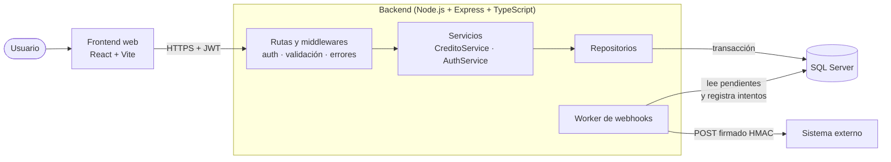
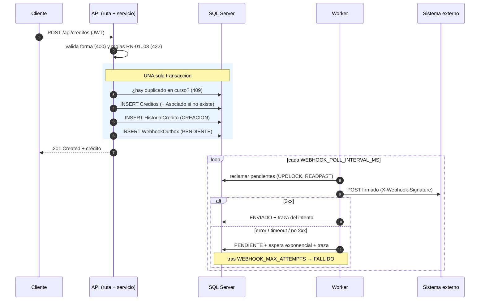
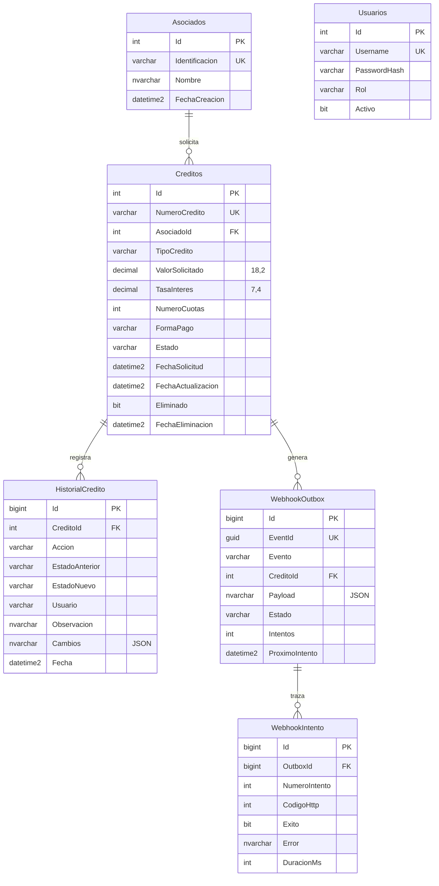

# Arquitectura

## 1. Vista general



- La API y el worker son el **mismo código** y pueden correr juntos (`WORKER_EMBEDDED=true`, cómodo en desarrollo) o como procesos separados (`npm run worker`, recomendado en producción).
- El único componente con estado es **SQL Server**. La API y el worker son *stateless*: todo lo que necesitan sobrevive en la base.

## 2. Capas y responsabilidades

```
backend/src
├── http/             Express: app.ts, rutas, middlewares (auth, validación, errores, requestId), OpenAPI
├── services/         Reglas de negocio: CreditoService, AuthService, WebhookDispatcher
├── domain/           Tipos, máquina de estados, reglas de validación, errores
├── repositories/
│   ├── interfaces.ts     Contratos (qué necesita el negocio de la persistencia)
│   ├── mssql/            Implementación real con SQL Server
│   └── memory/           Implementación en memoria (pruebas)
├── config/env.ts     Lectura y validación de variables de entorno
├── container.ts      Único lugar que ensambla las piezas reales
└── server.ts / worker.ts   Puntos de arranque
```

Las dependencias apuntan hacia adentro: `http → services → domain`, y los servicios hablan con **interfaces** de repositorio. Por eso las mismas reglas se ejecutan contra SQL Server en producción y contra memoria en las pruebas, sin cambiar una línea del servicio.

| Patrón | Dónde | Para qué |
|---|---|---|
| **Unit of Work** | `UnitOfWork.run(fn)` | Crédito + historial + evento de webhook se confirman juntos o ninguno. |
| **Repository** | `repositories/` | Aísla el SQL; el servicio no conoce tablas. |
| **Transactional Outbox** | `WebhookOutbox` | Entrega confiable del webhook sin transacciones distribuidas. |
| **Composition root** | `container.ts` | Un único lugar donde se crean las dependencias. |

## 3. Flujo de creación de un crédito (y su webhook)



**Cumplimiento del requisito clave del webhook:**
- *No se duplica la lógica de negocio:* `CreditoService.crear()` es el único lugar donde se crea un crédito; el worker no sabe crear créditos, solo enviar lo que quedó en el outbox.
- *No hay un segundo INSERT independiente:* el único INSERT del crédito ocurre una vez; el evento nace en esa misma transacción.
- *Hay traza:* cada evento y cada intento (código HTTP, error, duración) quedan en `WebhookOutbox` y `WebhookIntento`.

## 4. Qué pasa si el sistema externo falla (enunciado, sección 7)

El diseño garantiza que **el crédito nunca se pierde ni se bloquea** porque el externo falle: el crédito ya está confirmado cuando se intenta notificar.

| Situación | Qué hace el sistema |
|---|---|
| El externo **no responde** (timeout, `WEBHOOK_TIMEOUT_MS`) | Cuenta como intento fallido; se reintenta. |
| **Está caído** (conexión rechazada, DNS) | Igual: queda `PENDIENTE` con el error registrado. |
| Responde **error** (4xx / 5xx) | Igual: se registra el código HTTP y se reintenta. |
| Responde **2xx** | Evento `ENVIADO`. |
| Fallan todos los intentos (`WEBHOOK_MAX_ATTEMPTS`, 6 por defecto) | Queda `FALLIDO` (*dead letter*): deja de reintentarse y **se conserva** para revisión. Un ADMIN lo ve en `GET /api/webhooks/notificaciones` y lo reencola con `POST …/{id}/reintentar`. |
| La **API se cae** a mitad de un envío | El evento estaba "alquilado" (*lease*): cuando vence el plazo vuelve a quedar disponible y otro worker lo toma. No se pierde. |
| Hay **varios workers** | `UPDLOCK + READPAST` hace que cada uno tome filas distintas; nadie envía el mismo evento a la vez. |

**Reintentos con espera exponencial y jitter:** la espera es `base × 2^(n-1)` (30 s, 60 s, 120 s, 240 s, 480 s…) con tope de 1 h, y se aleatoriza entre la mitad y el total. Así, si el externo vuelve después de una caída, miles de eventos no lo golpean a la vez.

**Entrega "al menos una vez" e idempotencia:** un evento puede llegar más de una vez (por ejemplo, el externo recibió el POST pero la respuesta se perdió). Por eso cada evento lleva un `eventId` estable —el mismo en todos los reintentos— para que el receptor **deduplique**. El receptor de demostración lo hace.

**Autenticidad:** el cuerpo se firma con HMAC-SHA256 sobre `timestamp.cuerpo` (cabeceras `X-Webhook-Timestamp` y `X-Webhook-Signature`). El receptor verifica la firma con comparación de tiempo constante y rechaza timestamps de más de 5 minutos (anti-*replay*).

El enunciado permite "solo guardar la traza": además de la traza, el proyecto incluye un **receptor de demostración** (`POST /api/webhooks/demo-receptor`) para probar el flujo completo en local sin un sistema externo real.

## 5. Modelo de datos



`Usuarios` no tiene relación por llave foránea: el historial guarda el nombre de usuario como texto para conservar *quién actuó* aunque la cuenta se desactive después.

### Justificación del esquema (enunciado, sección 4)

| Decisión | Por qué |
|---|---|
| **PK surrogate `INT IDENTITY`** y llaves naturales como `UNIQUE` | Las FK son pequeñas y estables. Un documento o un número de crédito podrían corregirse; si fueran PK arrastrarían cambios en las tablas hijas. |
| **`DECIMAL(18,2)` para dinero, `DECIMAL(7,4)` para la tasa** | `float/double` acumula errores de redondeo binario: inaceptable con dinero. DECIMAL es exacto. |
| **`DATETIME2(3)` en UTC** con `SYSUTCDATETIME()` | Sin ambigüedad de zona horaria ni de horario de verano; el cliente convierte a hora local. Más preciso y de rango mayor que `DATETIME`. |
| **Estado como `VARCHAR` + `CHECK`** | Legible al auditar en SQL (`'APROBADO'`, no `3`). Un `CHECK` impide valores inválidos. Las *transiciones* no se pueden expresar bien en un `CHECK`, por eso viven en el servicio. |
| **`CHECK`** (`ValorSolicitado > 0`, `TasaInteres >= 0`, `NumeroCuotas > 0`, catálogos) | La base es la última barrera: protege ante scripts, migraciones o clientes que no pasen por la API. |
| **Borrado lógico** (`Eliminado` + `FechaEliminacion`) | En finanzas no se destruye información. Un `CHECK` impide estados incoherentes (eliminado sin fecha). |
| **`SEQUENCE` para `NumeroCredito`** | Atómica y sin bloqueos; `MAX()+1` genera duplicados bajo concurrencia. |
| **Campos obligatorios** (`NOT NULL`) | Todo campo del crédito es obligatorio; solo son `NULL` los que realmente pueden faltar (`FechaEliminacion`, `Observacion`, `Cambios`, estados del historial en creación/eliminación). |
| **Historial con `Cambios` en JSON** (con `CHECK ISJSON`) | Guarda `{campo: {antes, despues}}` sin una columna por cada campo editable. |

### Índices (cada uno responde a una consulta concreta)

| Índice | Consulta que acelera |
|---|---|
| `IX_Creditos_Estado_Fecha` (filtrado `Eliminado = 0`, con `INCLUDE`) | Listado por estado ordenado por fecha y dashboard (cubre las columnas sin ir a la tabla). |
| `IX_Creditos_Asociado` (filtrado) | Créditos de un asociado; también la FK. |
| **`UX_Creditos_Duplicado_Curso`** (único, filtrado a créditos en curso) | Garantiza la regla de duplicados incluso con peticiones simultáneas. |
| `IX_Historial_Credito_Fecha` | Historial de un crédito, del más reciente al más antiguo. |
| `IX_Outbox_Pendientes` (filtrado `Estado = 'PENDIENTE'`) | El worker solo mira lo pendiente: el índice es pequeño aunque la tabla crezca. |
| `IX_Outbox_Credito`, `IX_Intento_Outbox` | Trazas por crédito y por evento. |
| `UQ_*` (identificación, número de crédito, `EventId`, usuario) | Unicidad de las llaves naturales. |

Los índices filtrados requieren `QUOTED_IDENTIFIER ON`; el script lo declara y el `docker-compose` ejecuta `sqlcmd` con `-I`.
