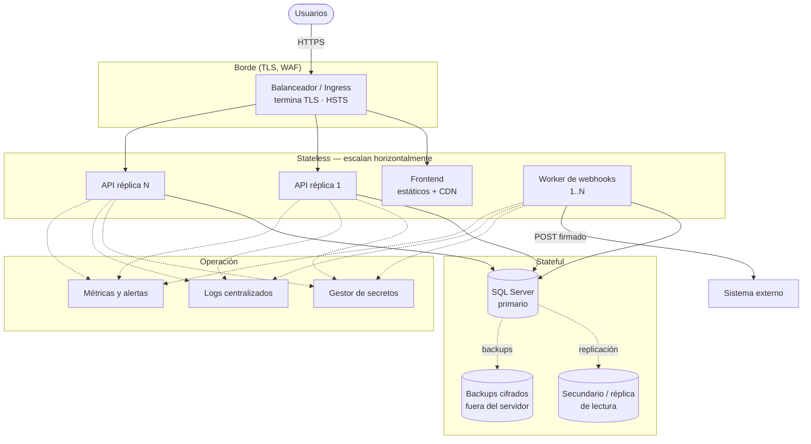

# Despliegue productivo y escalabilidad

Respuesta a las secciones 16 y 17 del enunciado. Describe la propuesta; **no todo está implementado** (el proyecto trae Docker Compose para desarrollo y demostración). Lo marcado como *ya está* sí existe en el código.

## 1. Cómo expondría la aplicación en producción



### 1.1 HTTPS
Un balanceador o *ingress* termina TLS (certificado gestionado y renovado automáticamente, TLS 1.2+), redirige HTTP→HTTPS y añade HSTS. La API queda en una red privada, sin puerto público. Se activa `TRUST_PROXY=true` para que el *rate limit* y los logs vean la IP real. La conexión API→SQL Server usa `DB_ENCRYPT=true` con certificado válido (`DB_TRUST_SERVER_CERT=false`). *Ya está:* Helmet, CORS y `X-Powered-By` desactivado.

### 1.2 Variables y secretos
Los secretos (`JWT_SECRET`, `DB_PASSWORD`, `WEBHOOK_SECRET`, claves iniciales) viven en un **gestor de secretos** (Azure Key Vault, AWS Secrets Manager, Vault o secretos de Kubernetes) y se inyectan como variables de entorno al arrancar. Nunca en el repositorio ni en la imagen. Se rotan periódicamente; para el JWT se acepta un periodo de gracia con dos claves. Las claves de usuarios iniciales (`SEED_*`) solo se usan en el primer arranque, luego se cambian. *Ya está:* toda la configuración por entorno, `.env` ignorado por git y validación al arrancar que en producción rechaza valores de ejemplo y un `JWT_SECRET` corto.

### 1.3 Backup de SQL Server
- **Completo** semanal + **diferencial** diario + **log de transacciones** cada 5–15 min → permite recuperación a un punto en el tiempo (*point-in-time*) con pérdida máxima de minutos (RPO) y la base en modo de recuperación `FULL`.
- Backups **cifrados** (TDE o cifrado del backup), copiados a **otra región/cuenta** y con retención definida (p. ej. 35 días + mensual anual).
- **Pruebas de restauración programadas**: un backup que nunca se restauró no es un backup. Se mide el tiempo de recuperación (RTO).
- En producción, preferible alta disponibilidad (Always On / servicio gestionado) con conmutación automática.

### 1.4 Logs
*Ya está:* logs JSON de una línea por evento (pino) con `requestId` en cada petición y en cada error, y secretos redactados. En producción se envían a una plataforma central (ELK, Loki, Azure Monitor, CloudWatch) con retención y búsqueda. El `requestId` permite seguir una petición del cliente al log. Los **logs de auditoría de negocio** ya están en la base (`HistorialCredito`), separados de los técnicos.

### 1.5 Health checks
*Ya están:* `GET /health` (*liveness*: el proceso responde) y `GET /health/ready` (*readiness*: además consulta la base; devuelve 503 si no responde). El orquestador usa *liveness* para reiniciar y *readiness* para sacar la réplica del balanceador sin reiniciarla. No se registran en el log para no inundarlo.

### 1.6 Monitoreo y alertas
Métricas clave: latencia p95/p99 y tasa de 5xx por endpoint; saturación del pool de conexiones y CPU de la base; esperas y bloqueos (*deadlocks*) en SQL Server; y específicas del negocio:
- **Edad del evento `PENDIENTE` más antiguo** y **cantidad de `FALLIDO`** en el outbox (alerta si crece: el externo está caído o hay un problema de firma).
- Tasa de 401/403 y de 429 (posible abuso).
Alertas por pager para lo que requiere acción inmediata; el resto, en tableros.

### 1.7 CI/CD
```
push / PR ─► instalar (npm ci) ─► typecheck ─► pruebas ─► build
          ─► auditoría de dependencias (npm audit) + escaneo de imagen
          ─► construir y publicar imagen versionada (por commit)
          ─► desplegar a staging ─► pruebas de humo (/health/ready, login, crear)
          ─► aprobación ─► producción (rolling o blue-green)
```
Las migraciones SQL se versionan y se aplican como paso del despliegue, antes de las réplicas nuevas (cambios *compatibles hacia atrás*: primero añadir, luego migrar código, luego quitar). Reversión rápida redesplegando la imagen anterior. *Ya está:* `npm test`, `npm run typecheck`, `npm run build` y un `Dockerfile` multi-etapa que se pueden conectar a este flujo tal cual.

### 1.8 ¿Qué es *stateless* y qué conserva estado?

| Componente | ¿Estado? | Por qué |
|---|---|---|
| **API** | *Stateless* | La sesión viaja en el JWT; nada se guarda en el proceso que no se pueda perder. Se puede escalar, reiniciar y reemplazar libremente. |
| **Worker de webhooks** | *Stateless* | Todo su estado (qué enviar, intentos, próximo reintento) vive en `WebhookOutbox`; si muere, otro continúa. |
| **Frontend** | *Stateless* | Archivos estáticos en CDN. |
| **SQL Server** | **Stateful** | Única fuente de verdad: créditos, historial, outbox, usuarios. Requiere backups, HA y almacenamiento persistente. |
| Contador del *rate limit* | Estado local (en memoria) | Aceptable con una réplica; con varias debe moverse a un almacén compartido (Redis). |

## 2. Escalabilidad: de 500 a 500.000 créditos/mes y múltiples cooperativas

### 2.1 Primero, dimensionar el problema
500.000 créditos/mes ≈ 16.700 al día ≈ 0,2 por segundo de media (con picos, quizá 10–50× más). **Escrituras de crédito de ese tamaño no son un problema para un SQL Server bien indexado.** Lo que cambia con ese crecimiento es otra cosa: el **volumen acumulado** (decenas de millones de filas de historial y outbox en pocos años), las **lecturas** (listados y dashboards de muchas cooperativas), el **aislamiento entre cooperativas** y la **operación** (un fallo ya no afecta a una entidad sino a muchas). Por eso la respuesta no es "microservicios y Kafka desde el día uno", sino cambiar *lo que realmente se rompe* y en el orden en que se rompe.

### 2.2 Problemas que aparecerían y qué cambiaría

| # | Problema futuro | Qué modificaría | Por qué |
|---|---|---|---|
| 1 | **Multi-tenancy:** hoy no existe el concepto de cooperativa; `Identificacion` es única global | Agregar `CooperativaId` a `Asociados`, `Creditos`, historial y outbox; llaves únicas **por cooperativa** (`CooperativaId + Identificacion`); el JWT lleva la cooperativa y **todas** las consultas se filtran por ella. Opcional: *Row-Level Security* de SQL Server como defensa en profundidad. Numeración de créditos por cooperativa. | Es el requisito de negocio nuevo y el más peligroso de hacer mal: una fuga entre cooperativas es un incidente grave. Mejor que un filtro "recordado" en cada query es forzarlo en una sola capa. |
| 2 | **Modelo de aislamiento:** ¿una base para todos o una por cooperativa? | Empezar con **una base compartida + `CooperativaId`**; las cooperativas muy grandes o con requisitos regulatorios, a **base propia** (mismo código, `ConnectionString` por tenant). | Una base por tenant aísla y simplifica el cumplimiento, pero multiplica operación y costo. El modelo híbrido da lo mejor de ambos. |
| 3 | **Crecimiento de tablas** (`HistorialCredito`, `WebhookOutbox`, `WebhookIntento`) | **Particionar por fecha** (mensual) las tablas de solo-inserción; **purgar/archivar** eventos `ENVIADO` con más de N días (el historial de auditoría se archiva, no se borra); mantenimiento de índices y estadísticas. `Id` pasa a `BIGINT`. | Tablas enormes degradan índices y backups. El índice filtrado del outbox ya mantiene al worker rápido, pero la tabla en sí crece sin límite. |
| 4 | **Lecturas pesadas** (listados, dashboard con `COUNT`/`SUM`) | **Réplica de lectura** (secundario legible de Always On) para listados y reportes; el dashboard sobre contadores precalculados o una caché de pocos segundos (Redis) en vez de agrupar en cada petición. Paginación por **cursor** (*keyset*) en lugar de `OFFSET`, que se degrada en páginas profundas. | Separa la carga de lectura de la de escritura sin tocar el modelo. |
| 5 | **Webhooks a muchos destinos** | Configuración de webhook **por cooperativa** (URL, secreto propio, eventos); **límite de tasa y *circuit breaker* por destino** para que un externo lento no consuma a todos los workers; el outbox migra a un **broker de mensajes** (Service Bus, RabbitMQ, Kafka) cuando un solo outbox SQL ya no baste, manteniendo el patrón: la fila de outbox sigue naciendo en la transacción y un *relay* la publica. Consumidores por tenant. | El diseño actual ya escala horizontalmente (varios workers con `READPAST`); el broker aporta aislamiento entre destinos y más rendimiento cuando haga falta, no antes. |
| 6 | **Concurrencia y carga en la API** | Más réplicas detrás del balanceador (ya es *stateless*); **rate limit con almacén compartido** (Redis) y por tenant, no solo por IP; ajuste del *pool* de conexiones; *autoscaling* por CPU/latencia. Los workers escalan aparte (`npm run worker`). | Es la parte más barata de escalar, pero el contador en memoria dejaría de ser correcto con varias réplicas. |
| 7 | **Cuellos de botella en SQL Server** | Revisar planes de ejecución y *Query Store*; índices según consultas reales; evitar bloqueos largos (las transacciones ya son cortas); alta disponibilidad (Always On); si una sola instancia se satura, **particionar por tenant** (varias bases/servidores). | Se optimiza con datos medidos, no por intuición. |
| 8 | **Operaciones masivas** (cargas de miles de créditos) | Endpoint o proceso de **carga por lotes asíncrona** con cola e informe de resultados, reutilizando `CreditoService.crear()` (todas las reglas, historial y evento por cada crédito). | La arquitectura en capas lo permite sin duplicar reglas: otro punto de entrada al mismo servicio. |
| 9 | **Observabilidad y fiabilidad** | Métricas por tenant, trazas distribuidas (OpenTelemetry), SLOs (p. ej. 99,9 % de disponibilidad, notificación en < 1 min para el 99 %), alertas sobre la edad del outbox. | A esa escala no basta con "mirar los logs". |
| 10 | **Seguridad y cumplimiento** | Roles por cooperativa, auditoría de accesos, cifrado de columnas sensibles (identificación) con Always Encrypted/TDE, políticas de retención y protección de datos personales. | Más entidades = más datos personales y más obligaciones regulatorias. |

### 2.3 Qué no cambiaría
- La **separación en capas** y los repositorios detrás de interfaces: permite migrar partes (outbox → broker, lecturas → réplica) sin reescribir el negocio.
- El **Transactional Outbox**: sigue siendo la forma correcta de publicar eventos de forma confiable; cambia el transporte, no el patrón.
- **SQL Server como fuente de verdad**: con índices, particionado y réplicas de lectura aguanta con holgura este volumen.

### 2.4 Orden de ejecución sugerido
1. Multi-tenancy (`CooperativaId` + JWT + filtro forzado) — es requisito, no optimización.
2. Réplica de lectura, caché del dashboard y paginación por cursor.
3. Rate limit compartido, autoscaling y observabilidad por tenant.
4. Partición y archivado de historial/outbox.
5. Broker de mensajes y bases por tenant **solo si** las métricas muestran que hace falta.
