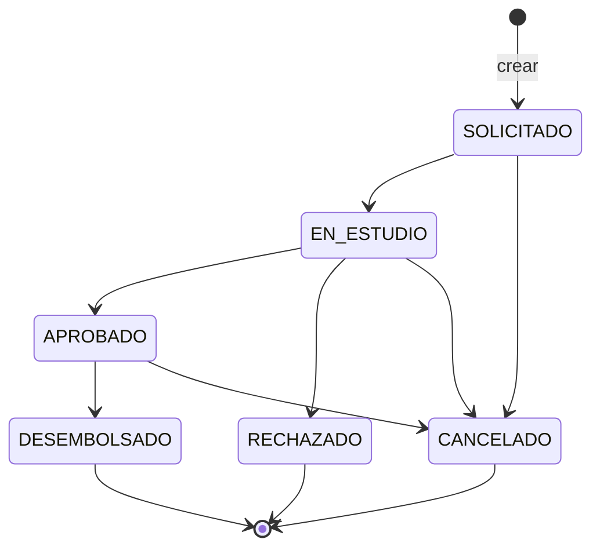

# Modelo de negocio

## 1. Qué resuelve el módulo

Una entidad del sector financiero solidario necesita administrar las **solicitudes de crédito de sus asociados**: registrarlas, consultarlas, corregirlas mientras siguen en estudio, decidirlas (aprobar o rechazar), desembolsarlas y conservar la trazabilidad de todo. Cada vez que se crea un crédito, un sistema externo debe enterarse (webhook).

## 2. Entidades

| Entidad | Qué representa | Tabla |
|---|---|---|
| **Asociado** | Persona que solicita créditos. Se identifica por su documento. | `Asociados` |
| **Crédito** | Solicitud con sus condiciones financieras y su estado. Es el producto principal. | `Creditos` |
| **Historial** | Registro inmutable de cada acción sobre un crédito (quién, cuándo, qué cambió). | `HistorialCredito` |
| **Usuario** | Persona que opera el sistema (ADMIN o ANALISTA). | `Usuarios` |
| **Notificación** | Evento pendiente/enviado al sistema externo, con la traza de cada intento. | `WebhookOutbox`, `WebhookIntento` |

Un asociado tiene muchos créditos; un crédito tiene muchas entradas de historial y muchas notificaciones.

## 3. Datos del crédito

Los campos pedidos por el enunciado (sección 3), con su tipo y restricción.

| Campo API | Columna | Tipo SQL | Regla |
|---|---|---|---|
| `id` | `Id` | INT IDENTITY | Lo genera la base. |
| `numeroCredito` | `NumeroCredito` | VARCHAR(20) UNIQUE | `CR-AAAA-######`, generado con una secuencia. |
| `identificacionAsociado` | `Asociados.Identificacion` | VARCHAR(20) UNIQUE | Solo dígitos, 5 a 15. |
| `nombreAsociado` | `Asociados.Nombre` | NVARCHAR(150) | 3 a 150 caracteres. |
| `tipoCredito` | `TipoCredito` | VARCHAR(30) + CHECK | Ver catálogo. |
| `valorSolicitado` | `ValorSolicitado` | **DECIMAL(18,2)** | > 0, máx. 2 decimales. |
| `tasaInteres` | `TasaInteres` | DECIMAL(7,4) | ≥ 0, máx. 4 decimales, tope 100. |
| `numeroCuotas` | `NumeroCuotas` | INT | Entero > 0, tope 360. |
| `formaPago` | `FormaPago` | VARCHAR(20) + CHECK | Ver catálogo. |
| `estado` | `Estado` | VARCHAR(20) + CHECK | Ver sección 5. |
| `fechaSolicitud` | `FechaSolicitud` | DATETIME2(3), UTC | La pone la base al insertar. |
| `fechaActualizacion` | `FechaActualizacion` | DATETIME2(3), UTC | Se actualiza en cada cambio. |

Campos internos que no salen por la API: `Eliminado` y `FechaEliminacion` (borrado lógico).

## 4. Catálogos

- **Tipos de crédito:** `LIBRE_INVERSION`, `VIVIENDA`, `VEHICULO`, `EDUCACION`, `CALAMIDAD`.
- **Formas de pago:** `NOMINA`, `CAJA`, `DEBITO_AUTOMATICO`, `PSE`.
- **Estados:** `SOLICITADO`, `EN_ESTUDIO`, `APROBADO`, `RECHAZADO`, `DESEMBOLSADO`, `CANCELADO` (los sugeridos por el enunciado, sin cambios).

El enunciado no define los tipos ni las formas de pago; los catálogos son una propuesta razonable para el sector y se validan en la API y con `CHECK` en la base. Agregar uno es cambiar una constante y el `CHECK`.

## 5. Ciclo de vida

`RECHAZADO`, `DESEMBOLSADO` y `CANCELADO` son **estados finales**: no tienen salida. Por eso `RECHAZADO → DESEMBOLSADO` (el ejemplo del enunciado) es imposible, igual que los saltos (`SOLICITADO → APROBADO`) y los retrocesos (`APROBADO → EN_ESTUDIO`).

| Transición | ¿Quién puede? | Observación |
|---|---|---|
| SOLICITADO → EN_ESTUDIO | ADMIN, ANALISTA | opcional |
| cualquiera → CANCELADO | ADMIN, ANALISTA | **obligatoria** |
| EN_ESTUDIO → APROBADO | solo ADMIN | opcional |
| EN_ESTUDIO → RECHAZADO | solo ADMIN | **obligatoria** |
| APROBADO → DESEMBOLSADO | solo ADMIN | opcional |

**Separación de funciones:** quien estudia el crédito (ANALISTA) no es quien decide si se aprueba, se rechaza o se desembolsa el dinero (ADMIN). Es un control interno estándar en entidades financieras.

## 6. Reglas de negocio

| # | Regla | Respuesta si se incumple |
|---|---|---|
| RN-01 | `valorSolicitado` > 0 (máx. 9.999.999.999.999,99; 2 decimales) | 422 `DATOS_CREDITO_INVALIDOS` |
| RN-02 | `tasaInteres` ≥ 0 (tope 100; 4 decimales) | 422 `DATOS_CREDITO_INVALIDOS` |
| RN-03 | `numeroCuotas` entero > 0 (tope 360) | 422 `DATOS_CREDITO_INVALIDOS` |
| RN-04 | **Duplicados:** no puede haber dos créditos *en curso* del mismo asociado con el mismo tipo y el mismo valor | 409 `CREDITO_DUPLICADO` |
| RN-05 | Solo se permiten las transiciones de la sección 5 | 409 `TRANSICION_INVALIDA` |
| RN-06 | APROBADO, RECHAZADO y DESEMBOLSADO solo los decide un ADMIN | 403 `PERMISO_DENEGADO` |
| RN-07 | Rechazar o cancelar exige un motivo | 422 `OBSERVACION_REQUERIDA` |
| RN-08 | Las condiciones solo se editan en SOLICITADO o EN_ESTUDIO | 409 `CREDITO_NO_MODIFICABLE` |
| RN-09 | Solo un ADMIN elimina, y no créditos APROBADOS ni DESEMBOLSADOS | 403 / 409 `CREDITO_NO_ELIMINABLE` |
| RN-10 | Un asociado es único por identificación; si ya existe se reutiliza | — |
| RN-11 | Toda creación, edición, cambio de estado y eliminación deja una entrada de historial | — |
| RN-12 | Crear un crédito registra el evento `credito.creado` en la misma transacción | — |

### La regla de duplicados (RN-04), explicada

> *Control de créditos duplicados según las condiciones definidas por el candidato.*

**Definición:** mismo asociado + mismo `tipoCredito` + mismo `valorSolicitado` mientras el otro crédito esté **en curso** (`SOLICITADO`, `EN_ESTUDIO` o `APROBADO`) y no esté eliminado.

**Por qué esa definición:**
- Detecta el caso real que se quiere evitar: el doble clic o el reenvío del formulario, y el mismo trámite cargado dos veces.
- Solo cuentan los créditos en curso. Si el anterior fue `RECHAZADO` o `CANCELADO`, repetir la solicitud es legítimo. Si ya fue `DESEMBOLSADO`, también: es un préstamo nuevo (otra necesidad, otro desembolso).
- Cambiar cualquiera de los tres datos (otro valor, otro tipo) lo convierte en una solicitud distinta.

**Dónde se garantiza:** dos veces, a propósito.
1. En la **capa de servicio**, antes de insertar: da un error claro (409 con mensaje).
2. En la **base de datos**, con el índice único filtrado `UX_Creditos_Duplicado_Curso`: cubre la carrera de dos peticiones simultáneas que pasarían la verificación a la vez. Si la base rechaza el INSERT, el repositorio lo traduce al mismo 409.

## 7. Roles y permisos

| Acción | ANALISTA | ADMIN |
|---|:-:|:-:|
| Crear, consultar, listar, ver historial y dashboard | ✔ | ✔ |
| Editar condiciones (estados SOLICITADO / EN_ESTUDIO) | ✔ | ✔ |
| SOLICITADO → EN_ESTUDIO, cancelar | ✔ | ✔ |
| Aprobar, rechazar, desembolsar | ✘ | ✔ |
| Eliminar (borrado lógico) | ✘ | ✔ |
| Consultar y reintentar notificaciones del webhook | ✘ | ✔ |

## 8. Qué es inmutable y qué es modificable (enunciado, sección 11)

En un sistema financiero la regla de oro es: **lo que ocurrió no se reescribe; solo se agregan hechos nuevos.**

**Inmutable (nunca se modifica después de creado):**
- `id` y `numeroCredito`: son la referencia del crédito para el asociado, el auditor y los sistemas externos.
- `identificacionAsociado` y `nombreAsociado` *desde el crédito*: pertenecen al asociado, no a la solicitud. Un crédito no puede "cambiar de dueño". La API rechaza esos campos al editar.
- `fechaSolicitud`: es el momento legal de la solicitud.
- **El historial completo**: solo se inserta. No hay `UPDATE` ni `DELETE` sobre él en el código.
- **Los eventos enviados** (`WebhookOutbox` en estado ENVIADO) y la traza de intentos.
- **Las condiciones financieras una vez APROBADO**: el asociado aceptó un valor, tasa y plazo concretos. Cambiarlos a posteriori sería alterar un compromiso. Si algo estuvo mal, se cancela y se crea otro crédito.

**Modificable, con control:**
- `tipoCredito`, `valorSolicitado`, `tasaInteres`, `numeroCuotas`, `formaPago`: solo mientras el crédito está `SOLICITADO` o `EN_ESTUDIO`. Cada cambio guarda el valor anterior y el nuevo en el historial (`{campo: {antes, despues}}`).
- `estado`: solo por `PATCH /estado`, siguiendo la máquina de estados, con usuario y fecha en el historial.
- `fechaActualizacion`: la mantiene el sistema, no el usuario.

**No se borra, se oculta:** `DELETE` es un borrado lógico. El crédito deja de aparecer en consultas, pero la fila y su historial se conservan para auditoría y para poder reconstruir lo ocurrido.

## 9. Dónde viven las reglas de negocio y por qué (enunciado, sección 6)

| Capa | Qué hace | Qué NO hace |
|---|---|---|
| **Controladores / rutas** (`http/routes`) | Traducen HTTP: leen la petición ya validada, llaman al servicio, dan formato a la respuesta. | No contienen reglas. |
| **Esquemas de petición** (`http/schemas.ts`) | Forma y tipos de los datos (¿es número? ¿falta un campo? ¿campos extra?). → **400** | No deciden reglas de negocio. |
| **Dominio y servicio** (`domain/`, `services/creditoService.ts`) | **Todas las reglas RN-01 a RN-12.** → 403 / 409 / 422 | No saben nada de HTTP ni de SQL. |
| **Base de datos** | Última red de seguridad: `CHECK` (valor > 0, tasa ≥ 0, cuotas > 0, estados válidos), `UNIQUE`, `FOREIGN KEY`, índice de duplicados. | No es el lugar donde se explican los errores al usuario. |

**Por qué en el servicio y no en los controladores:**
1. **Un solo punto de entrada.** Hoy lo usa la API; mañana puede usarlo un proceso de carga masiva o un consumidor de mensajes. Todos pasan por las mismas reglas y ninguno puede saltárselas.
2. **Se prueba sin HTTP ni base de datos.** Las pruebas del servicio corren en memoria en milisegundos.
3. **Es lo que pide el requisito del webhook:** la lógica de creación está en un solo lugar; el webhook no la duplica.

**Por qué *además* en la base de datos:** el servicio protege la aplicación; las restricciones protegen los **datos**. Un script manual, una migración o un bug futuro no pueden dejar un crédito con valor negativo ni dos créditos duplicados.

## 10. Supuestos a confirmar con el negocio

Cosas que el enunciado no define y que se decidieron para poder avanzar:

- La **tasa de interés** se maneja como porcentaje (`1.5` = 1,5 %). No se indica si es mensual o anual; el módulo no calcula cuotas, así que solo la almacena y valida.
- Los topes (valor, tasa 100, 360 cuotas) son límites técnicos razonables, no política de la entidad.
- La identificación del asociado es **numérica** (cédula). Si se necesitan NIT con dígito de verificación o pasaportes, se amplía la expresión regular.
- Si un asociado ya existe, **su nombre registrado prevalece** sobre el que llegue en una nueva solicitud (el nombre es dato del asociado, no del crédito).
